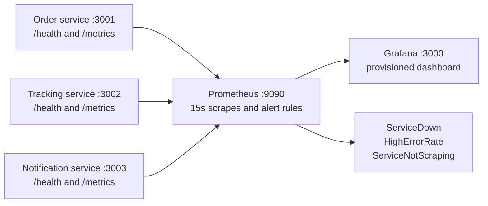

# WatchTower observability stack

WatchTower runs Reyla Logistics' order, tracking, and notification services with a provisioned Grafana dashboard for visualization, and Prometheus for collecting metrics and  alerts.

## Architecture



All containers share the `app-network` Docker network. The app containers use Docker's `json-file` logging driver with 10 MB file rotation and three retained files.

## Start and verify

Copy the sample environment file, then start the stack:

```sh
cp .env.example .env
docker compose up --build -d
```

- Check `http://localhost:3001/health`, `:3002/health`, and `:3003/health` for app health.
- Open Prometheus at <http://localhost:9090/targets>. The three service scrape targets should be **UP**. Alert rules appear at <http://localhost:9090/alerts>.
- Open Grafana at <http://localhost:3000> and select **WatchTower Services** in the WatchTower folder. The default local Grafana login is `admin` / `admin` unless changed on first login.


## Dashboard walkthrough

The provisioned **WatchTower Services** dashboard contains:

- **HTTP request rate by service:** HTTP requests per second, grouped by service.
- **5xx response rate by service:** 5xx responses per second, grouped by service.
- **Service health (Prometheus scrape status):** `UP` means Prometheus can scrape that service's `/metrics`; `DOWN` means the scrape failed.


## Alert rules and checks

Rules are defined in `prometheus/alerts.yml`, loaded through `prometheus/prometheus.yml`, and visible at <http://localhost:9090/alerts>.

| Alert | Trigger | Labels |
| --- | --- | --- |
| `ServiceDown` | Configured health probe reports failure continuously for 1 minute | `critical` |
| `HighErrorRate` | 5xx requests exceed 5% of requests over 5 minutes | `warning` |
| `ServiceNotScraping` | A service's Prometheus scrape is down for 2 minutes | `warning` |

## Structured logs

View live output from all three services:

```sh
docker compose logs --follow order-service tracking-service notification-service
```

Example:

```text
order-service | {"level":"info","service":"order-service","msg":"Listening on port 3001"}
tracking-service | {"level":"info","service":"tracking-service","msg":"Listening on port 3002"}
```

Filter one service to show error-level JSON records (requires `jq`):

```sh
docker compose logs --follow --no-log-prefix order-service | jq 'select((.level // "" | ascii_downcase) == "error" or (.log // "" | ascii_downcase | contains("error")))'
```

Example matching record:

```json
{"level":"error","service":"order-service","msg":"request failed"}
```
